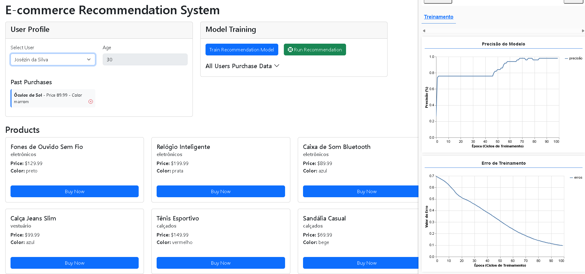

# E-commerce Recommendation System with TensorFlow.js

A browser-based e-commerce recommendation system that trains a neural network with **TensorFlow.js** directly in the browser. It learns from users' purchase history and ranks the product catalog by how likely each product is to be bought by the selected user.



## Features

- **User profiles**: select a user to see their age and past purchases.
- **Product catalog**: buy products with "Buy Now" and remove purchases from a user's history.
- **Model training in a Web Worker**: the neural network trains off the main thread, so the UI stays responsive.
- **Live training dashboard**: accuracy and loss charts are updated every epoch with `tfjs-vis`.
- **Personalized recommendations**: once the model is trained, selecting a user (or clicking **Run Recommendation**) reorders the product list by predicted purchase probability.
- **Cold start support**: users with no purchases still get recommendations based on their age.
- **Session persistence**: user and purchase data are stored in `sessionStorage`.

## How It Works

### 1. Feature encoding

Each product is turned into a numeric vector built from weighted features:

| Feature  | Encoding                                              | Weight |
| -------- | ----------------------------------------------------- | ------ |
| Category | One-hot                                               | 0.4    |
| Color    | One-hot                                               | 0.3    |
| Price    | Min-max normalized to `[0, 1]`                        | 0.2    |
| Age      | Normalized average age of the buyers of that product  | 0.1    |

Continuous values are normalized with `(value - min) / (max - min)` so no single feature dominates training.

Each **user** is represented as the mean of the vectors of the products they bought. Users with no purchases get a vector based only on their normalized age.

### 2. Training data

For every user with purchases, the user vector is concatenated with each product vector. The label is `1` if the user bought that product and `0` otherwise.

### 3. Neural network

A sequential model built with TensorFlow.js:

```
Dense(128, relu) → Dense(64, relu) → Dense(32, relu) → Dense(1, sigmoid)
```

- Loss: `binaryCrossentropy`
- Optimizer: Adam (learning rate `0.001`)
- 100 epochs, batch size 32, shuffled

### 4. Recommendation

For the selected user, the model predicts a score for every `(user, product)` pair. Products are sorted from highest to lowest score and rendered in that order.

## Project Structure

```
├── index.html                  # Main page
├── style.css                   # Styles
├── data/
│   ├── users.json              # Users and their purchase history
│   └── products.json           # Product catalog
└── src/
    ├── index.js                # Entry point: wires services, views, controllers and the worker
    ├── controller/             # Connects views, services, events and the worker
    │   ├── ModelTrainingController.js
    │   ├── ProductController.js
    │   ├── TFVisorController.js
    │   ├── UserController.js
    │   └── WorkerController.js
    ├── events/                 # Event bus and event name constants
    ├── service/                # Data access (JSON files + sessionStorage)
    ├── view/                   # DOM rendering, HTML templates and tfjs-vis dashboard
    ├── workers/
    │   └── modelTrainingWorker.js  # Feature encoding, training and inference
    └── image/
        └── project.png         # Screenshot
```

## Getting Started

### Prerequisites

- Node.js 18+ and npm
- A modern browser with ES modules and module Web Workers support

### Install and run

```bash
npm install
npm start
```

Then open `http://localhost:3000` in your browser.

## Usage

1. The model trains automatically on page load with the default users. You can retrain it at any time with **Train Recommendation Model**.
2. Follow accuracy and loss in the training dashboard.
3. Select a user in **User Profile**.
4. The product list is reordered with the recommendations for that user. Click **Run Recommendation** to refresh it.
5. Buy or remove products to change a user's history, then retrain to see how the recommendations change.

## Tech Stack

- [TensorFlow.js](https://www.tensorflow.org/js) 4.22 for model training and inference
- [tfjs-vis](https://github.com/tensorflow/tfjs/tree/master/tfjs-vis) for training charts
- [Bootstrap 5](https://getbootstrap.com/) and Bootstrap Icons for the UI
- [Browser-sync](https://browsersync.io/) as the development server
- Vanilla JavaScript (ES modules) with an MVC + event-driven structure

## References

See [refs.txt](refs.txt) for articles and resources used while building this project.
